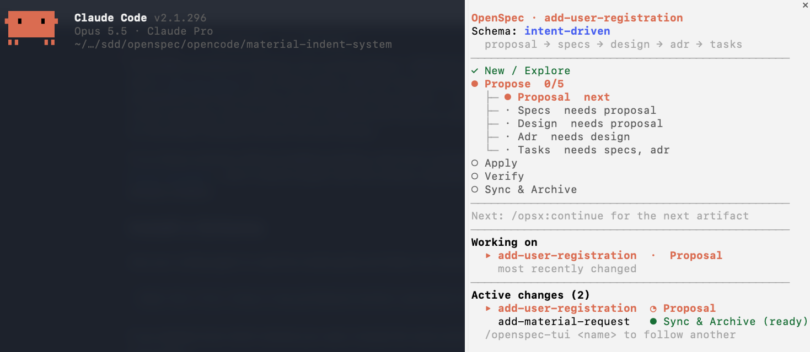

# claude-mods

Open-source mods for [Claude Code](https://claude.com/claude-code): live panes, status lines and hooks, written as plugins of function hooks.

## Mods

| Mod | What it does |
| --- | --- |
| [openspec-tui](plugins/openspec-tui) | A live side pane for OpenSpec: the change's journey (New / Explore → Propose, split into the schema's artifacts → Apply → Verify → Sync & Archive), the task being worked on, and the stage of every active change |



## Install

> While the repository is private, installing needs GitHub access to it: your `gh` or git credentials must be able to read `intent-driven-dev/claude-mods`.

### 1. Add the marketplace

Do this once. At the prompt of a Claude Code session:

```
/plugin marketplace add intent-driven-dev/claude-mods
```

or from your shell:

```sh
claude plugin marketplace add intent-driven-dev/claude-mods
```

This registers the marketplace under the name `claude-mods`.

### 2. Install a mod

```
/plugin install openspec-tui@claude-mods
```

or from your shell:

```sh
claude plugin install openspec-tui@claude-mods
```

Choose a scope when asked (`user`, `project` or `local`), then restart Claude Code to load the mod.

## Upgrade

First refresh the marketplace so Claude Code sees the latest versions, then update the mod:

```sh
claude plugin marketplace update claude-mods
claude plugin update openspec-tui@claude-mods
```

Restart Claude Code to apply the update. `claude plugin list` shows the version you have installed.

## Layout

```
.claude-plugin/marketplace.json   the marketplace: lists every mod
plugins/<mod>/                    one folder per mod (plugin.json, hooks, types, tests)
```

## Contributing

Issues and pull requests are welcome. Before opening a PR, run these on the mod you changed:

```sh
claude plugin validate ./plugins/<mod>
claude plugin test ./plugins/<mod>
```

## License

[MIT](LICENSE)
